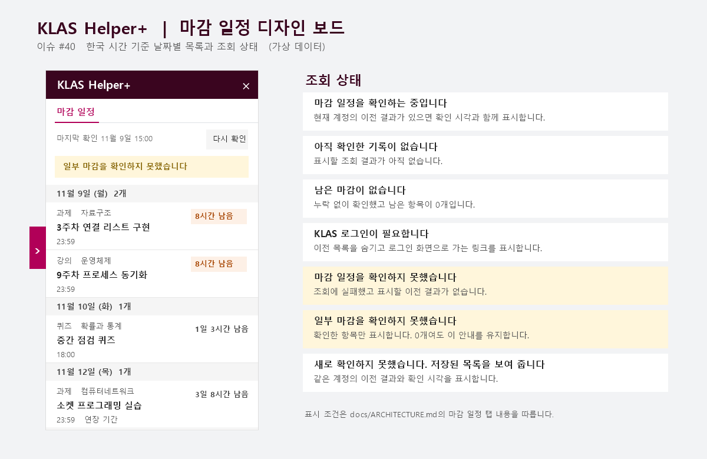

# KLAS Helper Extension Plus

광운대학교 KLAS의 **과제, 온라인 강의, 팀 프로젝트, 퀴즈 마감**을 오른쪽 패널에서 한눈에 확인하는 브라우저 확장입니다.

[최신 버전 다운로드](https://github.com/jundragon7419/klas-helper-extension-plus/releases/latest) · [변경 기록](CHANGELOG.md) · [문제 신고](https://github.com/jundragon7419/klas-helper-extension-plus/issues/new/choose)

*예시 데이터로 만든 마감 패널 디자인 시안입니다.*

## 기능

- **날짜별 마감 목록** — 아직 마치지 않은 과제, 온라인 강의, 팀 프로젝트, 퀴즈를 한국 시간 기준으로 정리합니다. 과제와 팀 프로젝트는 추가 제출 기한도 반영합니다.
- **과목별 목록 이동** — 마감 항목을 누르면 KLAS에서 해당 과목의 강의, 과제, 팀 프로젝트 또는 퀴즈 목록이 열립니다.
- **마지막 확인 시각과 다시 확인** — 패널을 처음 열 때 조회합니다. 같은 페이지에서 최근 결과를 다시 쓸 수 있고, 새로 조회하려면 새로고침 아이콘을 누르면 됩니다.
- **세션 자동 연장** — KLAS 탭이 열려 있는 동안 10분마다 연장합니다. 기본값은 켜짐이며 패널의 **설정 → 세션 자동 연장**에서 바꿀 수 있습니다.

## 지원 브라우저 및 설치

[GitHub 릴리스](https://github.com/jundragon7419/klas-helper-extension-plus/releases/latest)의 **Assets**에서 브라우저용 ZIP을 받습니다.

| 데스크톱 브라우저 | 파일 | 설치 방법 |
| --- | --- | --- |
| Google Chrome | `-chrome.zip` | 압축을 푼 뒤 `chrome://extensions`에서 **개발자 모드 → 압축해제된 확장 프로그램을 로드합니다**를 눌러 `manifest.json`이 들어 있는 폴더를 선택합니다. |
| Microsoft Edge | `-chrome.zip` | 압축을 푼 뒤 `edge://extensions`에서 **개발자 모드 → 압축 풀린 항목 로드**를 눌러 `manifest.json`이 들어 있는 폴더를 선택합니다. |
| Mozilla Firefox | `-firefox.zip` | `about:debugging#/runtime/this-firefox`에서 **임시 부가 기능 로드**를 눌러 ZIP을 선택합니다. Firefox를 다시 시작하면 임시 설치가 해제됩니다. |

[Chrome 설치 안내](https://developer.chrome.com/docs/extensions/get-started/tutorial/hello-world#load-unpacked) · [Edge 설치 안내](https://learn.microsoft.com/en-us/microsoft-edge/extensions/getting-started/extension-sideloading) · [Firefox 임시 설치 안내](https://extensionworkshop.com/documentation/develop/temporary-installation-in-firefox/)

## 사용 방법

1. [광운대학교 KLAS](https://klas.kw.ac.kr/)에 로그인하고 학생 화면을 엽니다. 설치 전에 열어 둔 탭이라면 새로고침합니다.
2. 화면 오른쪽의 **마감 일정 열기** 손잡이를 누릅니다. 항목을 누르면 해당 과목의 KLAS 목록으로 이동합니다.
3. 최신 목록은 패널의 **다시 확인** 버튼으로 조회합니다. 세션 자동 연장은 패널 상단의 **설정**에서 켜거나 끌 수 있습니다.

패널이 보이지 않으면 확장이 켜져 있고 KLAS에 대한 사이트 접근이 허용돼 있는지 확인하세요. 계속 문제가 생기면 브라우저와 확장 버전, 재현 순서를 적어 주세요. 이름, 학번, 성적이 보이는 화면은 가린 뒤 첨부해 주세요. [문제 신고](https://github.com/jundragon7419/klas-helper-extension-plus/issues/new/choose)

## 개인정보와 보안

- KLAS 요청은 열린 KLAS 탭에서 보냅니다. 조회한 마감과 계정 확인에 쓰는 학번 해시는 해당 페이지의 메모리에만 둡니다. 확장 개발자나 외부 서버로 보내지 않습니다.
- 로그인 화면에 입력한 아이디나 비밀번호에 접근하지 않습니다. 로그인 쿠키는 브라우저가 KLAS 요청에 붙이며, 확장에는 `cookies`와 `webRequest` 권한이 없습니다.
- `storage`는 자동 연장 설정과 대상 탭 목록을 보관하는 데 쓰고, `alarms`는 자동 연장 시점을 예약하는 데 씁니다.
- 공용 컴퓨터에서 사용을 마치면 KLAS에서 로그아웃하세요. 보안 문제는 공개 이슈 대신 비공개로 제보해 주세요. [개인정보처리방침](PRIVACY.md) · [보안 제보 방법](SECURITY.md)

## 개발과 기여

직접 빌드하거나 기여하려면 [기여 안내](CONTRIBUTING.md)를 참고하세요. [구조와 동작](docs/ARCHITECTURE.md)과 [로드맵](docs/ROADMAP.md)도 확인할 수 있습니다.

이 확장은 광운대학교의 공식 프로그램이 아닙니다. KLAS 화면이나 내부 API가 바뀌면 일부 기능이 동작하지 않을 수 있습니다. 원본 [KLAS Helper](https://github.com/kw-service/klas-helper-extension)를 만들고 유지해 온 kw-service 기여자분들께 감사드립니다.

[MIT 라이선스](LICENSE)
